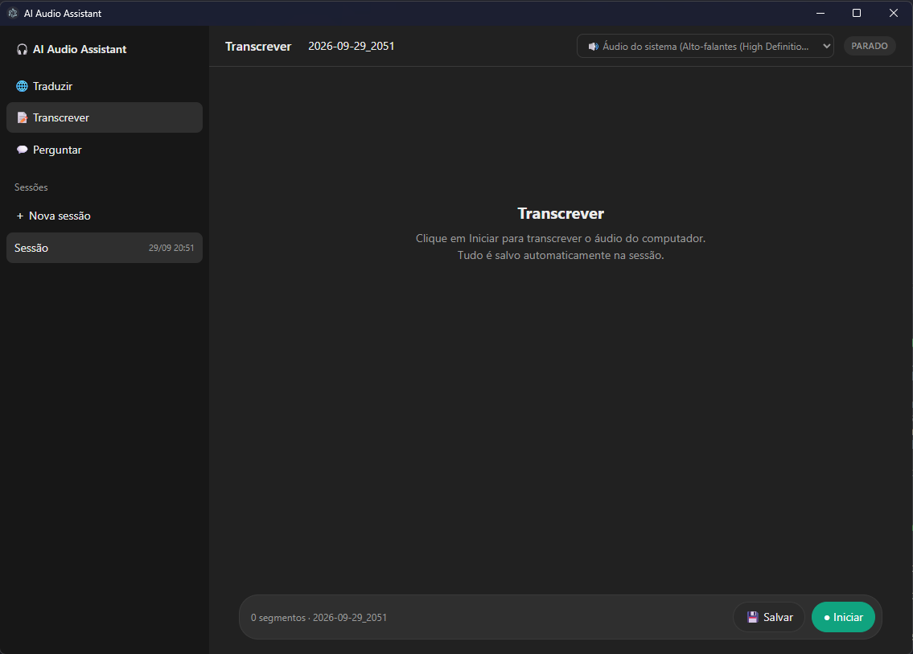

# AI Audio Assistant

App desktop (Electron + TypeScript) que **escuta o áudio** e:

- 🌐 **Traduz ao vivo**: vídeo, reunião ou podcast em outro idioma, com o texto traduzido aparecendo enquanto a pessoa fala.
- 📝 **Transcreve e salva**: transcrição contínua com timestamps, gravada automaticamente em sessões.
- 💬 **Responde perguntas** sobre uma sessão ("qual foi o principal assunto?"), usando só a transcrição e citando o tempo `[HH:MM:SS]`.

Suporte a **API da OpenAI** ou **100% local na sua GPU NVIDIA** ([whisper.cpp](https://github.com/ggml-org/whisper.cpp) + [llama.cpp](https://github.com/ggml-org/llama.cpp) em Docker).



## Recursos

- Captura do **áudio do sistema** (loopback WASAPI via Chromium, sem Stereo Mix e sem driver) ou de qualquer **entrada** (microfone, headset, cabo virtual).
- Interface estilo chat.
- Sessões em arquivos simples (`JSON` + `TXT`), que você reabre depois para continuar gravando ou para perguntar.
- Providers trocáveis por configuração: `openai` ou `local`, separados para transcrição e tradução.
- Chave de API só no processo main: a UI roda com `contextIsolation`, sem `nodeIntegration` e com sandbox.

## Como funciona

```text
Áudio do Windows ──► Chromium (WASAPI loopback) ──► AudioWorklet: PCM16 mono 24 kHz, chunks de 200 ms
                                                        │ IPC
                                                        ▼
                                                  processo main
                          ┌─────────────────────────────┼──────────────────────────────┐
                    Tradução                       Transcrição                     Perguntas
          openai: Realtime Translation      openai: Realtime (commit por VAD)    Responses API
          local:  whisper.cpp → llama.cpp   local:  whisper.cpp (trechos ≤3 s)   (transcrição inteira)
                                                        │
                                                        ▼
                                          data/sessions/<AAAA-MM-DD_HHmm>/
```

A detecção de fala (VAD) é feita no cliente, por RMS: um trecho termina depois de um silêncio curto ou quando chega ao tamanho máximo.

## Requisitos

- **Windows 10/11**, porque a captura do áudio do sistema usa o loopback do Windows.
- **Node.js 22+** e **pnpm** (ou npm).
- Para o modo OpenAI: uma `OPENAI_API_KEY`.
- Para o modo local: GPU **NVIDIA** com ~8 GB de VRAM livre (testado em uma RTX 3060 de 12 GB), driver **≥ 580** e **Docker**.

## Instalação

```sh
git clone https://github.com/filipebsmaia/ai-audio-assistant.git
cd ai-audio-assistant
copy .env.example .env    # edite o .env (veja Configuração)
pnpm install
pnpm start
```

## Configuração (`.env`)

| Variável | Padrão | Descrição |
|---|---|---|
| `TRANSCRIPTION_PROVIDER` | `openai` | `openai` ou `local` (whisper.cpp) |
| `TRANSLATION_PROVIDER` | `openai` | `openai` ou `local` (whisper.cpp + llama.cpp) |
| `OPENAI_API_KEY` | | Obrigatória para os providers `openai` e para o modo Perguntar |
| `OPENAI_TRANSLATION_MODEL` | `gpt-realtime-translate` | Tradução em tempo real |
| `OPENAI_SOURCE_TRANSCRIPTION_MODEL` | `gpt-realtime-whisper` | Texto original exibido durante a tradução |
| `OPENAI_TRANSCRIPTION_MODEL` | `gpt-live-transcribe` | Transcrição em tempo real |
| `OPENAI_CHAT_MODEL` | `gpt-6.1-sol` | Respostas do modo Perguntar |
| `LOCAL_WHISPER_URL` | `http://localhost:8080` | Servidor whisper.cpp |
| `LOCAL_WHISPER_MODEL` | `large-v3-turbo` | Modelo carregado pelo container (`ggml-<modelo>.bin`) |
| `LOCAL_LLM_URL` | `http://localhost:8081` | Servidor llama.cpp |
| `LOCAL_LLM_MODEL` | `ggml-org/gemma-3-4b-it-GGUF:Q4_K_M` | Modelo da Hugging Face (`repo:quant`) |
| `DATA_DIR` | `data` | Onde ficam as sessões |
| `LOG_AUDIO_LEVELS` | | `1` loga chunks/s e RMS a cada segundo (diagnóstico) |

O provider é escolhido quando o app abre. Ao iniciar, o terminal mostra qual está ativo: `[providers] transcrição: … | tradução: …`.

## Modo local (GPU NVIDIA)

### 1. Validar a GPU no Docker
```powershell
nvidia-smi
docker run --rm --gpus all nvidia/cuda:12.8.0-base-ubuntu24.04 nvidia-smi
```
Se a sua GPU aparecer nos dois comandos, o ambiente está pronto.

### 2. Transcrição local (whisper.cpp)
```bash
scripts/download-whisper-model.sh large-v3-turbo   # Git Bash/WSL; baixa ~1,6 GB uma única vez
docker compose up -d whisper
docker compose logs -f whisper                      # procure "RTX" e "using CUDA0 backend"
```
No PowerShell:
```powershell
docker compose run --rm --no-deps whisper "./models/download-ggml-model.sh large-v3-turbo /models"
```
Teste com o áudio de exemplo que vem na imagem:
```bash
docker compose exec whisper curl -s localhost:8080/inference -F file=@/app/samples/jfk.wav -F response_format=json
```
Depois coloque `TRANSCRIPTION_PROVIDER=local` no `.env`. Para menos latência ou menos VRAM, use `LOCAL_WHISPER_MODEL=medium`: baixe o modelo e rode `docker compose up -d whisper` de novo.

### 3. Tradução local (llama.cpp + Gemma 3 4B)
```bash
docker compose up -d whisper llm      # na 1ª vez o llama.cpp baixa o modelo (~2,4 GB)
docker compose logs -f llm            # espere "listening on http://0.0.0.0:8080"
```
Teste:
```bash
curl -s localhost:8081/v1/chat/completions -H "Content-Type: application/json" \
  -d '{"messages":[{"role":"system","content":"Translate to Brazilian Portuguese. Output only the translation."},{"role":"user","content":"Good morning, everyone."}]}'
```
Depois coloque `TRANSLATION_PROVIDER=local` no `.env`. Para mais qualidade, use `LOCAL_LLM_MODEL=ggml-org/gemma-3-12b-it-GGUF:Q4_K_M`, que precisa de ~8 GB de VRAM e fica no limite de 12 GB junto com o Whisper.

**Desempenho medido numa RTX 3060 (12 GB):**
- Whisper `large-v3-turbo`: ~0,5 s para transcrever cada trecho de 3 s.
- Gemma 3 4B: ~0,2 s por frase (~75 tokens/s).
- VRAM com os dois modelos carregados: ~7 GB.
- A tradução local vai **frase a frase** e aparece ~1 s depois de cada trecho. A da OpenAI é contínua.

## Uso

1. Escolha a **fonte de áudio** no topo:
   - **🔊 Áudio do sistema (…)**: tudo o que está tocando na saída padrão do Windows (o nome entre parênteses), como vídeos, reuniões e músicas.
   - **🎙 Microfone / entrada**: qualquer dispositivo de entrada (microfones, headsets, webcams, Stereo Mix, cabos virtuais). A lista se atualiza ao conectar ou desconectar um dispositivo, e a escolha fica salva.
2. **Traduzir**: escolha o idioma de destino e clique em **Iniciar**. O idioma de origem é detectado automaticamente.
3. **Transcrever**: clique em **Iniciar**. Tudo é gravado na sessão atual, e você pode clicar no nome da sessão, no topo, para renomear.
4. **Perguntar**: faça perguntas sobre a sessão aberta. **🎙 Ouvir** continua transcrevendo enquanto você pergunta.
5. **💾 Salvar** exporta o conteúdo da tela: tradução e transcrição em `.txt`, perguntas e respostas em `.md`.

As sessões ficam em `data/sessions/<AAAA-MM-DD_HHmm>/`:
- `metadata.json`: `{ name, createdAt }`
- `transcript.json`: `[{ timestamp, clock, text }]`, em que `timestamp` é o tempo desde a criação da sessão
- `transcript.txt`: `[HH:MM:SS] texto`, com a hora local

## Estrutura do projeto

```text
src/
  shared/              tipos e contrato de IPC usados pelo main e pela UI
  main/                processo main (Node)
    index.ts           janela, captura do áudio do sistema, inicialização
    ipc.ts             estado da captura e handlers chamados pela UI
    config.ts          leitura do .env (único lugar)
    sessionStore.ts    sessões em disco
    audio/             PCM/WAV e detecção de fala (speechSegmenter)
    lib/               utilitários (fila serial)
    providers/
      types.ts         interfaces TranscriptionProvider / TranslationProvider
      index.ts         escolhe openai | local a partir do .env
      openai/          Realtime (transcrição e tradução) e perguntas
      local/           whisper.cpp e llama.cpp
  preload/             ponte segura (contextBridge) para window.api
  renderer/            UI: index.html, styles.css e módulos TypeScript
    views/             cabeçalho, barra lateral e os três modos
scripts/               build e download de modelo do Whisper
docker-compose.yml     serviços locais: whisper e llm
```

Para adicionar um provider novo, implemente a interface em `src/main/providers/types.ts` e escolha-o em `src/main/providers/index.ts`. Nenhuma outra parte do app precisa mudar.

## Scripts

| Comando | O que faz |
|---|---|
| `pnpm start` | Build + abre o app |
| `pnpm build` | Limpa `dist/` e compila o main, o preload e o renderer |
| `pnpm typecheck` | Checagem de tipos dos dois lados (main e renderer) |
| `pnpm test` | Testes unitários (`node:test`): VAD, PCM/WAV, fila e sessões |

## Limitações

- Entre as **saídas** (alto-falantes, fones), só a **saída padrão** do Windows pode ser capturada, pela opção 🔊. As opções 🎙 do seletor são **entradas** (microfones etc.). Para capturar uma saída que não é a padrão, ou só um app específico, mande o áudio dela para um cabo virtual (ex.: VB-Cable) e escolha **🎙 CABLE Output** no seletor ou simplesmente trocar a saída padrão no Windows.
- O áudio traduzido não é reproduzido; aparece apenas o texto.
- Não há reconexão automática: em caso de erro, tudo para e basta clicar em Iniciar de novo.
- O modo Perguntar usa a OpenAI e envia a transcrição inteira (limitada aos últimos ~500 mil caracteres).
- O histórico de perguntas não é gravado na sessão. Use 💾 Salvar para guardar.
- O VAD é simples (limiar de RMS): música de fundo contínua conta como fala.
- O modo local corta a fala contínua a cada 3 s, o que às vezes parte uma palavra. Ajuste em `src/main/providers/local/whisperTranscription.ts` (`MAX_SEGMENT_MS`).

## Licença

[MIT](LICENSE)
